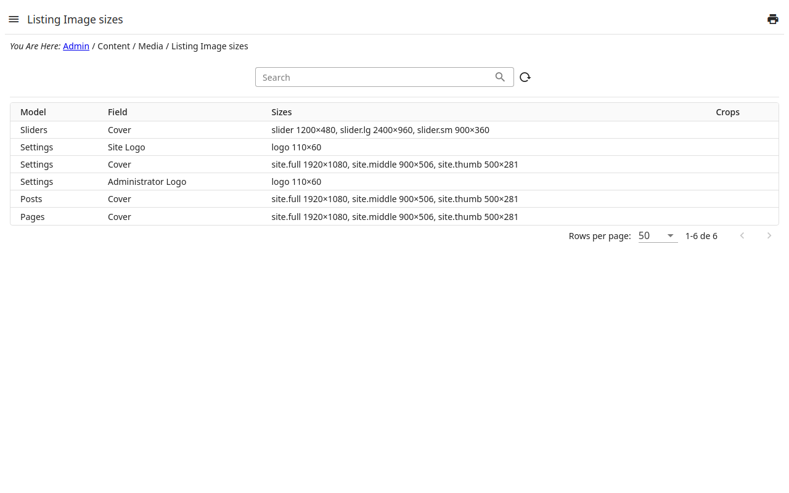

# Image sizes

Each field of images of the admin — the cover of a page, the picture of a
slider, the logo of the site… — has its **sizes**: the crops the site shows
of the image chosen there, each with a name (what the site's templates ask
for), a width and a height.

- The sizes start as the **site's own** (written in its code). Edit a field
  to set **yours**: its table of sizes — a name, a width, a height —; the
  list says when the sizes in use are yours.
- Saving new sizes **makes the crops again** of every file the field shows,
  in the background: the column **Crops** says how far it went (being made,
  made, or what went wrong). The area of a crop is kept when its proportion
  is the same; otherwise the largest area of the new proportion, centered in
  the image, is used — crop it again in the media library to choose another.
- Two fields may share a size's name only in the **same measures**: a file
  used in both would otherwise be cropped in one, then the other.
- Back to the site's sizes: set the table as the site's again; when the site's
  own sizes change in a new version, the crops are made again by themselves.
