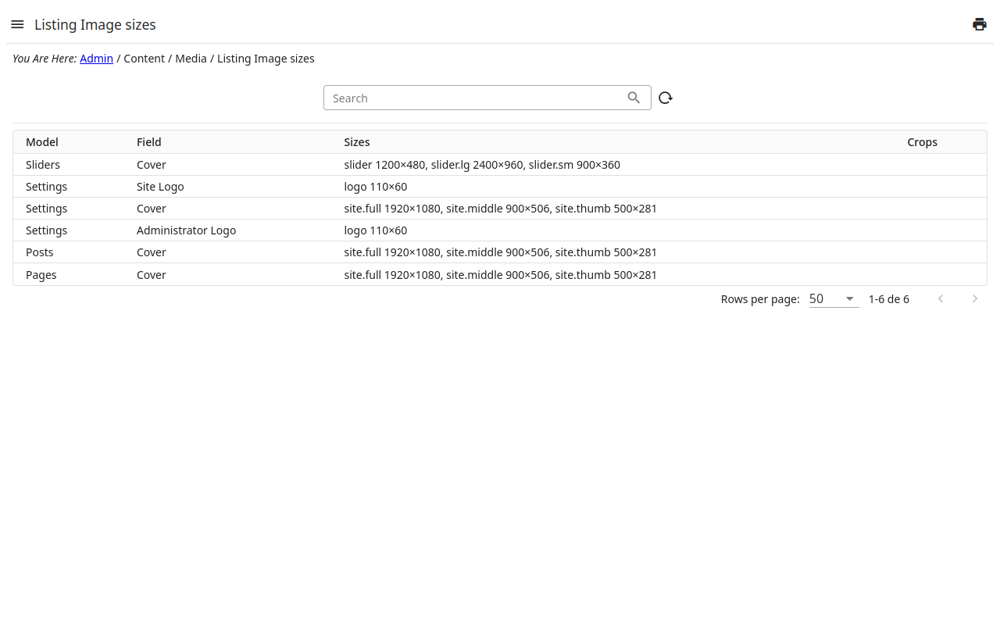

# Image sizes

Each field of images of the admin — the cover of a page, the picture of a
slider, the logo of the site… — has its **sizes**: the crops the site shows
of the image chosen there, each with a name (what the site's templates ask
for), a width and a height.

- The sizes start as the **site's own** (written in its code). Edit a field
  to set **yours**: its table of sizes — a name, a width, a height —; the
  list says when the sizes in use are yours.
- Saving new sizes **makes the crops again** of every file the field shows,
  in the background: the column **Crops** says how far it went (being made,
  made, or what went wrong). The area of a crop is kept when its proportion
  is the same; otherwise the largest area of the new proportion, centered in
  the image, is used — crop it again in the media library to choose another.
- Two fields may share a size's name only in the **same measures**: a file
  used in both would otherwise be cropped in one, then the other.
- Back to the site's sizes: set the table as the site's again; when the site's
  own sizes change in a new version, the crops are made again by themselves.

## Formats

A **format** is a proportion with a name — **Retrato 3:4**, **Quadrado
1:1** — a record's image may be cropped in, instead of the field's sizes: the
cover of a page in portrait, when the others are landscape.

- **Image formats** lists the site's formats: a **label**, a **name**
  (lower-case letters, digits, `-`: the suffix of the crops, as
  `site.full_retrato`; not changed once made) and the **proportion**
  (width:height). The ones **Of the code** come with the system and are not
  deleted; a format a field offers is not either.
- **Formats of the fields** says which formats each field offers: choose the
  **Field** and the **Format** in the selectors, the **Position** among the
  field's formats and, if you want, the **Width of the largest**. The column
  **Sizes in the field** shows the crops the format will have there.
- A format's sizes in a field are the field's in its proportion: each size
  keeps its **shorter side**. In a field of 1920×1080, 900×506 and 500×281,
  **Retrato 3:4** crops in 1080×1440, 506×675 and 281×375, **Quadrado 1:1**
  in 1080×1080, 506×506 and 281×281. With a **Width of the largest**, the
  largest size is that wide and the others follow its proportion.
- In a record, the field's image shows **Format**: **Default** (the field's
  sizes) or one of the formats the field offers. Choosing one crops the image
  in it at once; save and publish the record.
- The site asks for the same sizes as ever (`site.full`): a record of a
  format gets its crops. Nothing changes in the templates.
- Offering a format in a field, or changing a format's proportion, makes the
  field's crops again in the background (the column **Crops** of **Image
  sizes**). Taking a format off a field brings the records that used it back
  to **Default** (publish them again for the site to show it).
