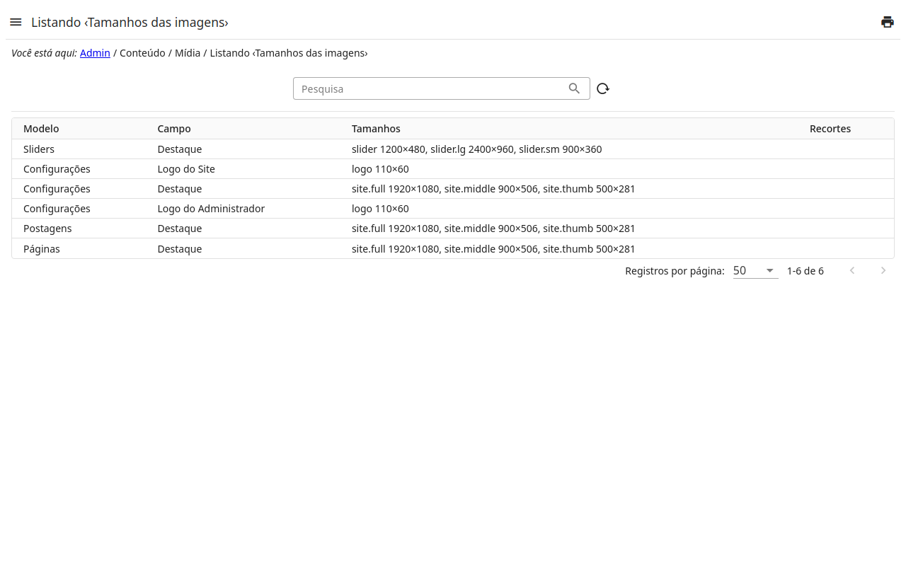

# Tamanhos das imagens

Cada campo de imagens do admin — a capa de uma página, a imagem de um
slider, o logo do site… — tem os seus **tamanhos**: os recortes que o site
mostra da imagem escolhida ali, cada um com um nome (o que os templates do
site pedem), uma largura e uma altura.

- Os tamanhos começam como os **do site** (escritos no código dele). Edite um
  campo para definir os **seus**: a tabela de tamanhos — nome, largura,
  altura —; a lista diz quando os tamanhos em uso são os seus.
- Salvar tamanhos novos **refaz os recortes** de todos os arquivos que o
  campo mostra, em segundo plano: a coluna **Recortes** diz até onde foi (em
  andamento, prontos, ou o que deu errado). A área de um recorte é mantida
  quando a proporção é a mesma; senão, usa-se a maior área da proporção nova,
  centralizada na imagem — recorte de novo na biblioteca de mídia para
  escolher outra.
- Dois campos só podem ter um tamanho de mesmo nome com as **mesmas
  medidas**: senão, um arquivo usado nos dois seria recortado em um, depois
  no outro.
- Para voltar aos tamanhos do site, deixe a tabela como a do site; quando os
  tamanhos do próprio site mudam numa versão nova, os recortes são refeitos
  sozinhos.
