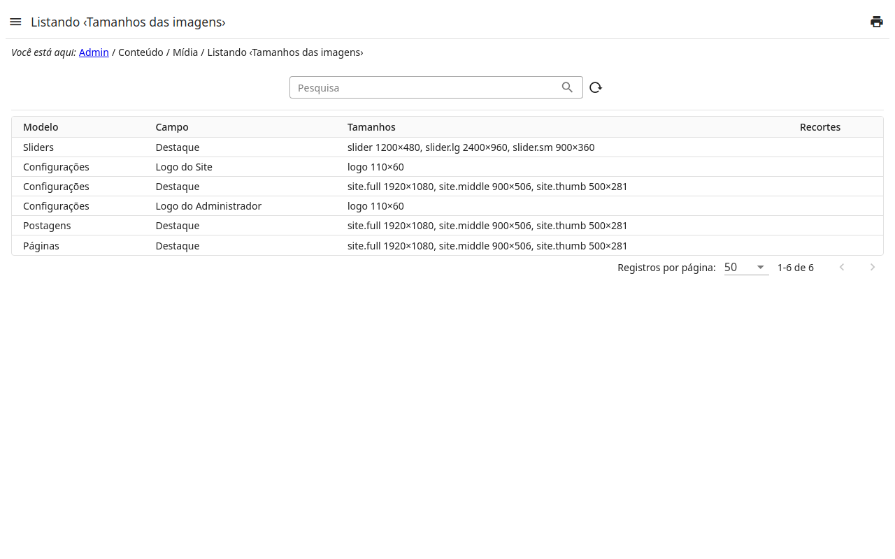

# Tamanhos das imagens

Cada campo de imagens do admin — a capa de uma página, a imagem de um
slider, o logo do site… — tem os seus **tamanhos**: os recortes que o site
mostra da imagem escolhida ali, cada um com um nome (o que os templates do
site pedem), uma largura e uma altura.

- Os tamanhos começam como os **do site** (escritos no código dele). Edite um
  campo para definir os **seus**: a tabela de tamanhos — nome, largura,
  altura —; a lista diz quando os tamanhos em uso são os seus.
- Salvar tamanhos novos **refaz os recortes** de todos os arquivos que o
  campo mostra, em segundo plano: a coluna **Recortes** diz até onde foi (em
  andamento, prontos, ou o que deu errado). A área de um recorte é mantida
  quando a proporção é a mesma; senão, usa-se a maior área da proporção nova,
  centralizada na imagem — recorte de novo na biblioteca de mídia para
  escolher outra.
- Dois campos só podem ter um tamanho de mesmo nome com as **mesmas
  medidas**: senão, um arquivo usado nos dois seria recortado em um, depois
  no outro.
- Para voltar aos tamanhos do site, deixe a tabela como a do site; quando os
  tamanhos do próprio site mudam numa versão nova, os recortes são refeitos
  sozinhos.

## Formatos

Um **formato** é uma proporção com nome — **Retrato 3:4**, **Quadrado 1:1** —
em que a imagem de um registro pode ser recortada, em vez dos tamanhos do
campo: a capa de uma página em retrato, quando as outras são em paisagem.

- **Formatos de imagem** lista os formatos do site: um **rótulo**, um
  **nome** (letras minúsculas, dígitos, `-`: o sufixo dos recortes, como
  `site.full_retrato`; não muda depois de criado) e a **proporção**
  (largura:altura). Os marcados **Do código** vêm com o sistema e não são
  excluídos; um formato oferecido por algum campo também não.
- **Formatos dos campos** diz quais formatos cada campo oferece: escolha o
  **Campo** e o **Formato** nos seletores, a **Posição** entre os formatos
  do campo e, se quiser, a **Largura do maior**. A coluna **Tamanhos no
  campo** mostra os recortes que o formato terá ali.
- Os tamanhos de um formato num campo são os do campo na proporção dele:
  cada tamanho mantém o seu **lado menor**. Num campo de 1920×1080, 900×506
  e 500×281, **Retrato 3:4** recorta em 1080×1440, 506×675 e 281×375, e
  **Quadrado 1:1** em 1080×1080, 506×506 e 281×281. Com uma **Largura do
  maior**, o maior tamanho tem essa largura e os outros seguem a proporção.
- No registro, a imagem do campo mostra **Formato**: **Padrão** (os tamanhos
  do campo) ou um dos formatos que o campo oferece. Escolher um recorta a
  imagem nele na hora; salve e publique o registro.
- O site pede os mesmos tamanhos de sempre (`site.full`): o registro de um
  formato recebe os recortes dele. Nada muda nos templates.
- Oferecer um formato num campo, ou mudar a proporção de um formato, refaz os
  recortes do campo em segundo plano (a coluna **Recortes** de **Tamanhos
  das imagens**). Tirar um formato de um campo devolve a **Padrão** os
  registros que o usavam (publique-os de novo para o site mostrar).
