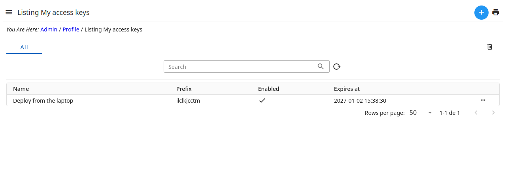
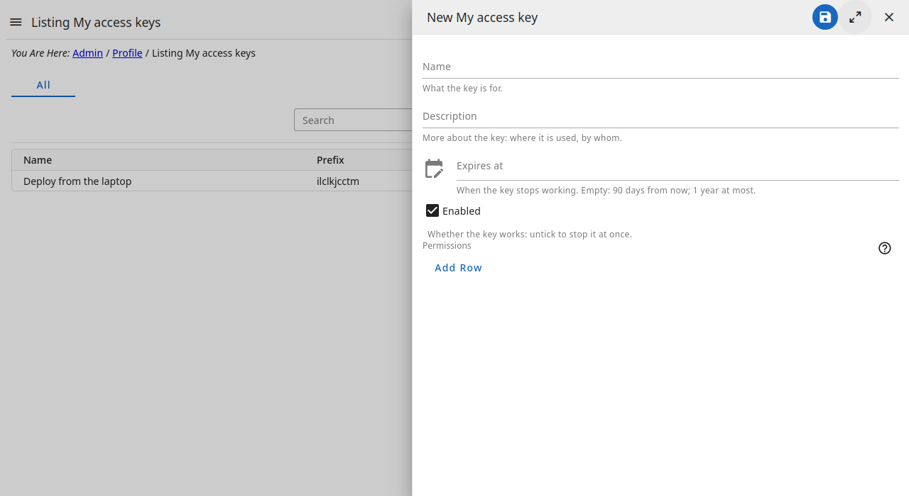
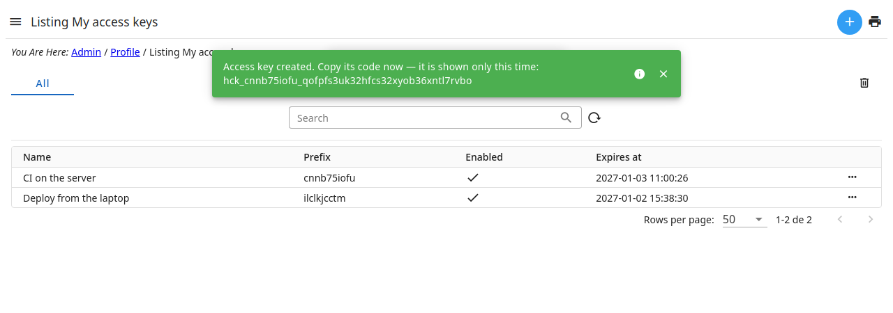
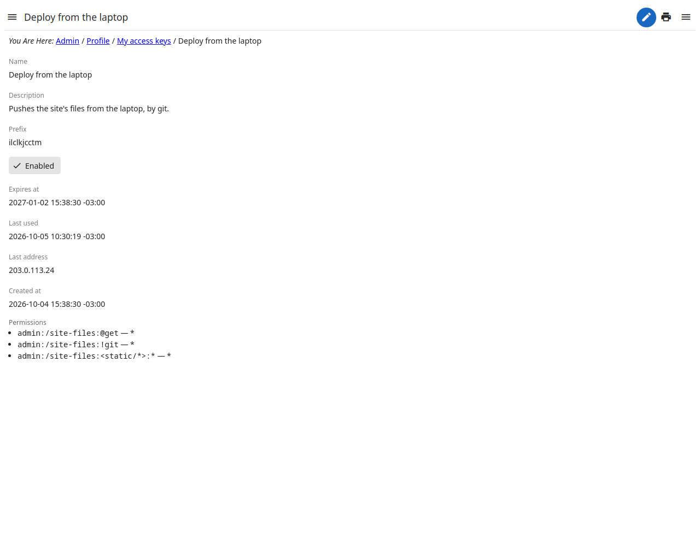
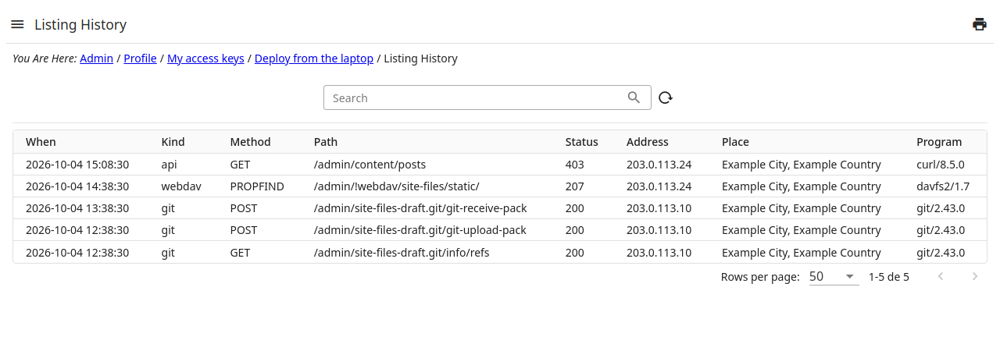

# My keys

An **access key** is a code an automation — **git**, a **WebDAV** program,
a script — signs in with in your name, with no password and no session: each
request carries the key.



## Making a key



1. In **My keys**, make a key: give it a **name** (what it is for), how long
   it **lasts** (90 days when left empty; 1 year at most) and its
   **permissions**.
2. When saved, its **code** is shown **only once**: `hck_…`. Copy it and
   keep it safe. It is not kept anywhere — only a digest (hash) of it —; lost,
   make another key.
   

3. To stop a key at once: untick **Enabled**, or delete the key.

## The permissions

A key's permissions **only deny**: a request by the key may **all you
may**, **but what the key denies**. A key never gives more than you have —
and, **with no permission, it may all you may**.

They are a **list**, a deny a line: `deny` **and a space**, and a resource,
written as a role's are (see
: `*` matches
anything, `{a,b}` one of the alternatives). A line without the `deny`, or
with `allow` or `reset`, is not taken — nor a group with an alternative that
does not deny (`admin:users:{deny @edit, @list}`).

Examples:

| Permissions | May | May not |
| --- | --- | --- |
| (none) | all you may | — |
| `deny admin:users:*` | all but the users | the users |
| `deny admin:users:{@edit,@delete}` | all, and see the users | edit and delete users |
| `deny admin:/site-files:!publish` | all, and change the draft of the site's files | publish the site's files |
| `deny admin:{users,roles}:*`<br>`deny admin:/site-files:!publish` | all but users, roles and publishing | users, roles, publishing |

The `!` of an action inside the resource (`admin:/site-files:!publish`) is
the resource's: the prefix is only the `deny ` at the start of the line.

A key of before the denies (with lines of no prefix — what it reached) still
reaches only them until it is saved again, then with denies only.



A key never makes nor changes keys — not even yours.

## Using it

- **git:** the password is the code (the user may be anything):

  ```
  git clone https://<the-site>/admin/site-files-draft.git
  # user: your login; password: hck_…
  ```

- **WebDAV:** the same — the user and, as the password, the code.
- **A script:** the header `Authorization: Bearer <code>`:

  ```
  curl -H "Authorization: Bearer hck_…" https://<the-site>/admin/…
  ```

## The history



Each request by the key is in its **History**: when, from where (address
and place), by which program, what (git, webdav, api; the path) and how it
went. It is also in your **access log** (the sessions of your profile), as
"Access key: *name*" — one line each half hour by address and program, not
one a request.
