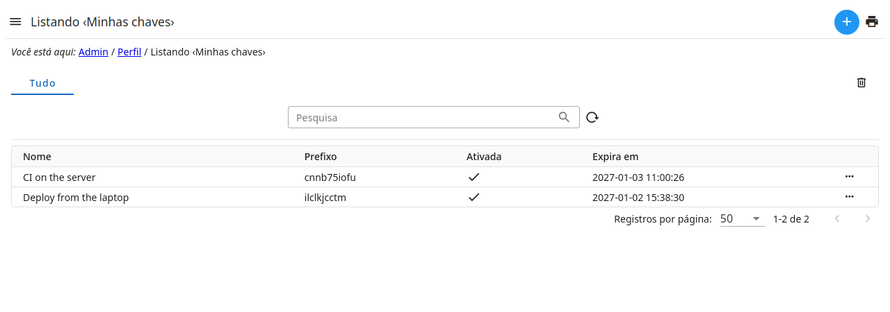
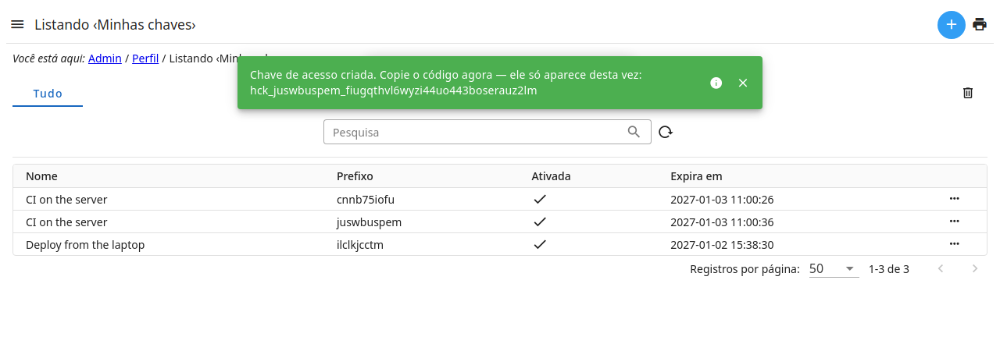
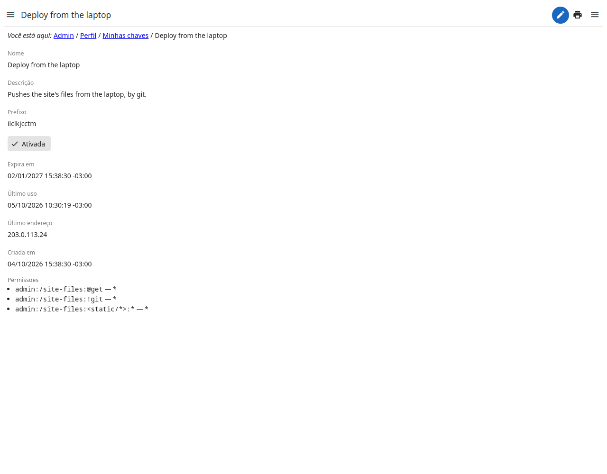
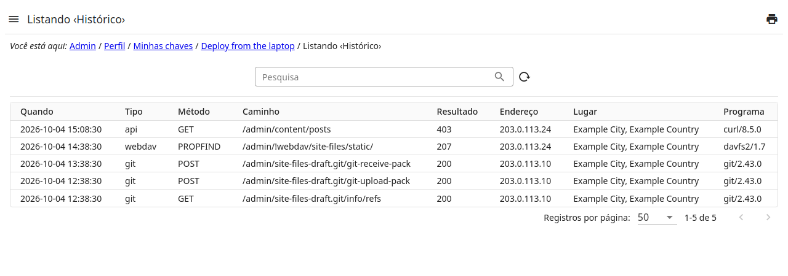

# Minhas chaves

Uma **chave de acesso** é um código com que uma automação — o **git**, um
programa de **WebDAV**, um script — entra em seu nome, sem senha e sem
sessão: cada requisição traz a chave.



## Criar uma chave


1. Em **Minhas chaves**, crie uma chave: dê um **nome** (para que ela serve),
   a **validade** (90 dias se ficar vazia; no máximo 1 ano) e as
   **permissões**.
2. Ao salvar, o **código** aparece **uma única vez**:
   `hck_…`. Copie e guarde num lugar seguro. Ele não é guardado em lugar
   nenhum — só um resumo (hash) dele —; perdeu, crie outra chave.
   

3. Para parar uma chave na hora: desmarque **Ativada**, ou exclua a chave.

## As permissões

As permissões de uma chave **só negam**: um pedido feito pela chave pode
**tudo o que você pode**, **menos o que a chave nega**. Uma chave nunca dá
mais do que você tem — e, **sem nenhuma permissão, pode tudo o que você
pode**.

São negações: `deny` **e um espaço**, e um recurso, escrito como os dos
papéis (veja : `*`
casa com qualquer coisa, `{a,b}` com uma das alternativas). Uma linha sem o
`deny`, ou com `allow` ou `reset`, não é aceita — nem um grupo com uma
alternativa que não negue (`admin:users:{deny @edit, @list}`).

São editadas no **campo de permissões** (o mesmo dos papéis): a árvore do
que **você** pode, cada linha com o prefixo **—** ou **NEGA**, e a coluna
**Ativa** mostrando o que a chave ainda alcança.

Exemplos:

| Permissões | Pode | Não pode |
| --- | --- | --- |
| (nenhuma) | tudo o que você pode | — |
| `deny admin:users:*` | tudo, menos os usuários | os usuários |
| `deny admin:users:{@edit,@delete}` | tudo, e ver os usuários | editar e excluir usuários |
| `deny admin:/site-files:!publish` | tudo, e mudar o rascunho dos arquivos do site | publicar os arquivos do site |
| `deny admin:{users,roles}:*`<br>`deny admin:/site-files:!publish` | tudo, menos usuários, papéis e publicar | usuários, papéis, publicar |

O `!` de uma ação dentro do recurso (`admin:/site-files:!publish`) é do
recurso: o prefixo é só o `deny ` do começo da linha.

Uma chave de antes das negações (com linhas sem prefixo — o que ela
alcançava) continua alcançando só elas até ser salva de novo, então só com
negações.



Uma chave nunca cria nem altera chaves — nem as suas.

## Usar

- **git:** a senha é o código (o usuário pode ser qualquer um):

  ```
  git clone https://<o-site>/admin/site-files-draft.git
  # usuário: seu login; senha: hck_…
  ```

- **WebDAV:** o mesmo — usuário e, como senha, o código.
- **Um script:** o cabeçalho `Authorization: Bearer <código>`:

  ```
  curl -H "Authorization: Bearer hck_…" https://<o-site>/admin/…
  ```

## O histórico



Cada pedido feito pela chave fica no **Histórico** dela: quando, de onde
(endereço e lugar), por qual programa, o quê (git, webdav, api; o caminho) e
o resultado. E aparece também no seu **log de acesso** (as sessões do seu
perfil), como "Chave de acesso: *nome*" — uma linha a cada meia hora por
endereço e programa, não uma por pedido.
