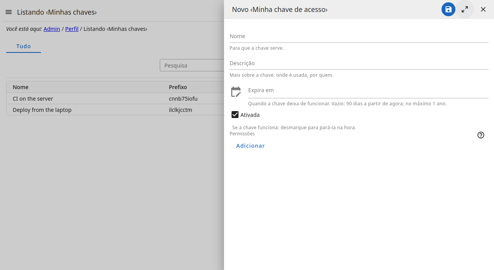

# Minhas chaves

Uma **chave de acesso** é um código com que uma automação — o **git**, um
programa de **WebDAV**, um script — entra em seu nome, sem senha e sem
sessão: cada requisição traz a chave.


## Criar uma chave



1. Em **Minhas chaves**, crie uma chave: dê um **nome** (para que ela serve),
   a **validade** (90 dias se ficar vazia; no máximo 1 ano) e as
   **permissões**.
2. Ao salvar, o **código** aparece **uma única vez**:
   `hck_…`. Copie e guarde num lugar seguro. Ele não é guardado em lugar
   nenhum — só um resumo (hash) dele —; perdeu, crie outra chave.
   

3. Para parar uma chave na hora: desmarque **Ativada**, ou exclua a chave.

## As permissões

As permissões de uma chave dizem **o que ela libera do que você pode**: um
pedido feito pela chave pode **só o que as linhas dela liberam**, e nunca
mais do que você tem. **Sem nenhuma permissão, a chave não alcança nada.**

São linhas escritas como as dos papéis (veja
: `*` casa com
qualquer coisa, `{a,b}` com uma das alternativas):

- um recurso, sem prefixo, **libera** o recurso (`admin:posts:*`; `*`: tudo
  o que você pode);
- `deny ` e um recurso tira uma parte de algo liberado antes
  (`deny admin:posts:*:@delete`);
- `allow ` e um recurso devolve uma parte negada antes;
- `reset` não é aceito.

São editadas no **campo de permissões** (o mesmo dos papéis), montado do
**que você pode**: o que você não pode nem aparece para liberar. Cada linha
tem o prefixo **CONCEDE** (libera), **NEGA** ou **LIBERA** (devolve), e a coluna **Ativa**
mostra o que a chave alcança.

Exemplos:

| Permissões | Pode | Não pode |
| --- | --- | --- |
| (nenhuma) | nada | — |
| `*` | tudo o que você pode | — |
| `admin:os_users:<id>:!ssh` | entrar no usuário do SO `<id>` por SSH | o resto |
| `admin:posts:*`<br>`deny admin:posts:*:@delete` | os posts, menos excluir | excluir posts, o resto |
| `*`<br>`deny admin:users:*` | tudo o que você pode, menos os usuários | os usuários |
| `*`<br>`deny admin:/site-files:!publish` | tudo, e mudar o rascunho dos arquivos do site | publicar os arquivos do site |

O `!` de uma ação dentro do recurso (`admin:/site-files:!publish`) é do
recurso: o prefixo é só o `deny ` do começo da linha.


Uma chave nunca cria nem altera chaves — nem as suas.

## Usar

- **git:** a senha é o código (o usuário pode ser qualquer um):

  ```
  git clone https://<o-site>/admin/site-files-draft.git
  # usuário: seu login; senha: hck_…
  ```

- **WebDAV:** o mesmo — usuário e, como senha, o código.
- **Um script:** o cabeçalho `Authorization: Bearer <código>`:

  ```
  curl -H "Authorization: Bearer hck_…" https://<o-site>/admin/…
  ```

## O histórico


Cada pedido feito pela chave fica no **Histórico** dela: quando, de onde
(endereço e lugar), por qual programa, o quê (git, webdav, api; o caminho) e
o resultado. E aparece também no seu **log de acesso** (as sessões do seu
perfil), como "Chave de acesso: *nome*" — uma linha a cada meia hora por
endereço e programa, não uma por pedido.
