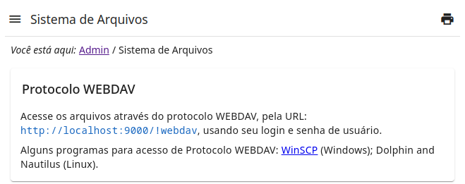

# FS Tools

This module provides access to File System.

Features:

- Authentication using user and password credentials;
- WEBDAV access protocol;
- the explorer of the page (`<vx-files>`, `explorer`): the same files the
  WebDAV serves — browse, upload (in parts, folders too), edit, rename, copy,
  delete, download a folder as zip, extract an archive; the WebDAV's address,
  account and folders in the panel and in the button of its bar;
- the terminal of the page (F4): a shell in the folders, in a sandbox.

## The components

`assets/vx-files.js` and `assets/vx-terminal.js` (with xterm in
`assets/vendor`) are served by `UseAssets(presets)`; other pages use them too
(senir: the files of a user of the OS, its IDE). The explorer's API is the
package `explorer` over any `webdav.FileSystem`.

## The terminal

A feature, `rvq.fstools.terminal`: on unless app.yml turns it off
(`features: {rvq.fstools.terminal: false}`); left out of the binary by the
build tag `rvq.fstools.noterminal`. It is opened by who has the page's
`!terminal` permission (in no set of permissions: give it by hand).

The shell sees `$FILES_ROOT`, a folder of links to the folders of the system
it reaches (the folders of `RVQ_FSTOOLS_DIRS`, the mounts), each read or
written as the user may; its `HOME` and `TMPDIR`, a temporary folder of the
session, removed at its end. Nothing else of the server: the
`sandbox` package keeps it apart.

```yaml
fstools:
  terminal:
    # auto: bwrap (namespaces of mounts, processes, network), else Landlock
    # (the kernel's restriction: files; TCP from Linux 6.7; signals from
    # 6.12); neither: the terminal is off, the reason in the panel of the
    # WebDAV. bwrap | landlock: only that one. off: no sandbox — the shell
    # reaches what the server does.
    sandbox: auto
    network: false   # TCP of the shell
    shell: ""        # default /bin/bash, else /bin/sh
    limits:
      cpu: 10m       # time of CPU
      memory: 2G     # virtual memory
      file_size: 1G  # size of a file written
      processes: 0   # RLIMIT_NPROC: counts the server's processes too
    idle: 30m        # with no input, closed
```

Below Linux 6.12, Landlock does not isolate the signals: the shell may
signal the processes of the server's user. bwrap needs unprivileged
namespaces of users, often refused (AppArmor's
`apparmor_restrict_unprivileged_userns`, Docker's seccomp).

<style>
figure {
  border: thin silver solid;
  display: flex;
  flex-flow: column;
  padding: 5px;
}

figcaption {
  background-color: #222222;
  color: white;
  font: italic smaller sans-serif;
  padding: 3px;
  text-align: center;
}
</style>

<figure>
    
    <figcaption>File System page</figcaption>
</figure>