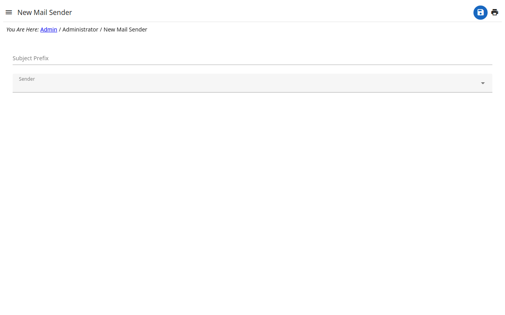

# Mail sending

A single settings screen: the account every e-mail of the site is sent
through — the messages of the contact forms, the password resets, the
notifications — and who reads the answers to them. There is no list of
senders: what is set here holds for everything.

The settings have two tabs, in the detail and in the edit form:

- **Sending** — how the e-mails go out:
  - the **sending method**: **Gmail**, a Google account authorized from the
    panel itself, or **SMTP**, a server and its account (host, port, user,
    password). Only the account of the method chosen is used; the other one
    is kept;
  - the **subject in parts**: `Re: [PAC] [ISSUE - Issues] [#12] Title` — the
    answer (`Re:`, always first), the **site name in the subject** (empty, the
    one of the site's settings), the **thing** the e-mail is of (the issue's
    type, the form), the **record** (`#12`) and the title. The table
    **Subject parts** says, by type of message (contact, forms, issues;
    **Others** for the rest) and to whom it goes (**To the team**, **To
    outside** — who wrote through the site, the author), which parts each
    subject has;
  - the **IDs in the body**: at the end of every message of a record, the
    record (`hermon:issue:…`), the `Message-ID` and the kind, in small print —
    what finds the message in a mailbox many things write to, and what an
    answer that lost its headers still quotes. The same go in the headers
    `X-Mail-Record` and `X-Mail-Kind`, for the server's filters;
  - the **limits per address**: how many e-mails one address outside the
    team (whoever wrote through the site, a customer) gets per hour and per
    day. Past them the e-mail is refused and the error recorded; e-mails to
    the team itself do not count. The limits keep a form of the site from
    being used to flood somebody's mailbox. `0`: no limit;
  - for how many days  keeps each e-mail
    sent (365 by default; `0`, for ever).
- **Answers** — who reads what people answer to the e-mails:
  - **People, in the team mailbox**: the answers reach the team's mailbox
    and are read there, as any e-mail;
  - **The application, by IMAP**: the application reads the mailbox by IMAP;
    an answer to a conversation it knows (a contact message, a comment)
    becomes part of it — found by its headers, or by the ID it quotes —, and the
    message, as **After importing** says: marked read, deleted from the server
    or moved to a folder (by default, the domain of the sending's address).
    Only it is touched: deleting needs the server's UIDPLUS extension and
    moving MOVE (or UIDPLUS); without them it is only marked read. The
    fields of the IMAP server are shown in this mode only. When the mailbox
    that receives is the one that sends, mark in **The same as the SMTP**
    what the reading takes from the account of the **Sending** tab — the
    user, the password, the host —; each one marked leaves the form (one
    password to change). The options and examples are in .

The passwords (of the SMTP account and of the IMAP mailbox) are never shown
in the detail. In the edit form the password saved is in its field, hidden
(the eye icon shows it): clearing it removes it.

Every e-mail sent, or that failed, is in , its sensitive content hidden.

Before the site relies on the account, check it with
.

## In development and in the tests

With the environment variable `RVQ_MAIL_SMTP` (say `127.0.0.1:2525`), every
e-mail goes to that SMTP server, whatever method is set here — and nothing
leaves the machine. rvq's test server (`make mail-dev`) receives there,
prints each message as it arrives and makes it readable by IMAP
(`127.0.0.1:1143`, any address, password `test`): the mode **The
application, by IMAP** is tested with it. In production the variable is not
set.
