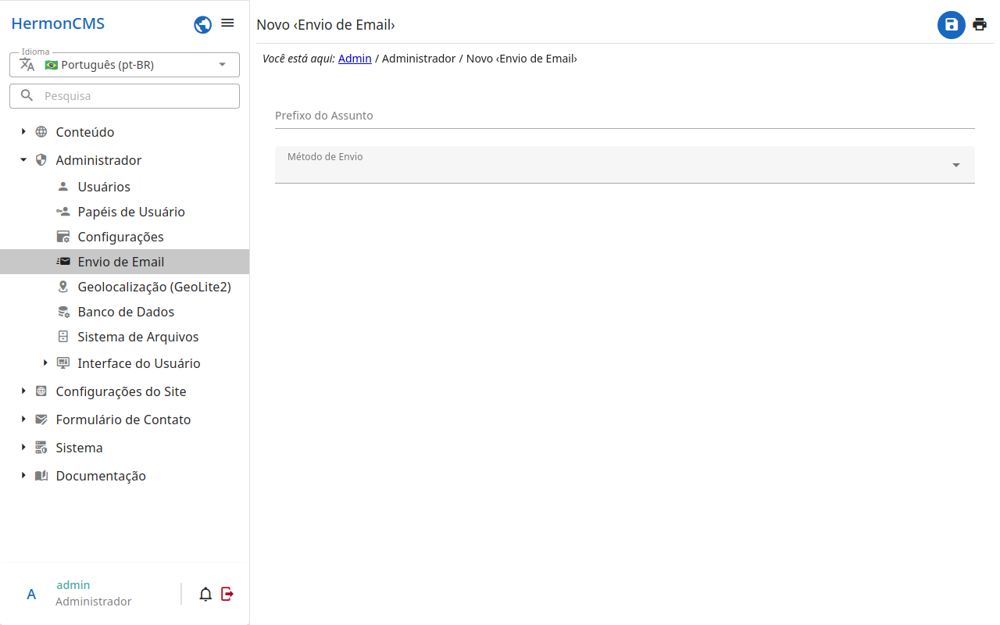

# Envio de e-mails

Uma tela só, de configuração: a conta pela qual saem todos os e-mails do
site — as mensagens dos formulários de contato, as redefinições de senha, as
notificações — e quem lê as respostas a eles. Não há uma lista de
remetentes: o que se configura aqui vale para tudo.

A configuração tem duas abas, no detalhe e na edição:

- **Envio** — como os e-mails saem:
  - o **Método de envio**: **Gmail**, uma conta do Google autorizada pelo
    próprio painel, ou **SMTP**, um servidor e a sua conta (servidor, porta,
    usuário, senha). Só a conta do método escolhido é usada; a do outro fica
    guardada;
  - o **assunto em partes**: `Re: [PAC] [CHAMADO - Chamados] [#12] Título`
    — a resposta (`Re:`, sempre na frente), o **nome do site no assunto**
    (vazio, o das configurações do site), a **coisa** de que o e-mail é (o
    tipo do chamado, o formulário), o **registro** (`#12`) e o título. A
    tabela **Partes do assunto** diz, por tipo de mensagem (contato,
    formulários, chamados; **Outros** para o resto) e a quem vai (**Para a
    equipe**, **Para fora** — quem escreveu pelo site, o autor), que partes
    cada assunto tem;
  - os **IDs no corpo**: ao fim de toda mensagem de um registro, o registro
    (`hermon:issue:…`), o `Message-ID` e o tipo, em letra pequena — o que acha
    a mensagem numa caixa de entrada usada por várias coisas, e o que uma
    resposta que perdeu os cabeçalhos ainda cita. Os mesmos dados vão nos
    cabeçalhos `X-Mail-Record` e `X-Mail-Kind`, para os filtros do servidor;
  - os **limites por endereço**: quantos e-mails um mesmo endereço de fora
    da equipe (quem escreveu pelo site, um cliente) recebe por hora e por
    dia. Acima disso o e-mail é recusado e o erro fica registrado; os
    e-mails para a própria equipe não contam. Os limites impedem que um
    formulário do site seja usado para encher a caixa de alguém. `0`: sem
    limite;
  - por quantos dias a  guarda cada
    e-mail enviado (padrão 365; `0`, para sempre).
- **Respostas** — quem lê o que as pessoas respondem aos e-mails:
  - **Pessoas, na caixa da equipe**: as respostas chegam à caixa de e-mail
    da equipe e são lidas lá, como qualquer e-mail;
  - **A aplicação, por IMAP**: a aplicação lê a caixa pelo IMAP; a resposta
    a uma conversa que ela conhece (uma mensagem de contato, um comentário)
    passa a fazer parte dela — achada pelos cabeçalhos, ou pelo ID que ela
    cita —, e a mensagem, como diz **Depois de importar**: marcada como lida,
    excluída do servidor ou movida para uma pasta (por padrão, o domínio do
    endereço de envio). Só ela é tocada: excluir pede a extensão UIDPLUS do
    servidor e mover pede MOVE (ou UIDPLUS); sem elas, a mensagem só é marcada
    como lida. Os
    campos do servidor IMAP só aparecem neste modo. Quando a caixa que recebe
    é a mesma que envia, marque em **O mesmo do SMTP** o que a
    leitura aproveita da conta da aba **Envio** — o usuário, a senha, o
    servidor —; cada um marcado some do formulário (uma senha só para
    trocar). As opções e os exemplos estão na .

As senhas (da conta SMTP e da caixa IMAP) nunca são mostradas no detalhe.
Na edição a senha salva vem no campo, oculta (o ícone do olho a mostra):
apagá-la a remove.

Todo e-mail enviado, ou que falhou, fica na , com o conteúdo sensível oculto.

Antes de o site depender da conta, confira-a com
.

## Em desenvolvimento e nos testes

Com a variável de ambiente `RVQ_MAIL_SMTP` (por exemplo
`127.0.0.1:2525`), todo e-mail vai para esse servidor SMTP, seja qual for o
método configurado aqui — e nada sai da máquina. O servidor de testes do
rvq (`make mail-dev`) recebe ali, mostra cada mensagem que chega e a deixa
legível por IMAP (`127.0.0.1:1143`, qualquer endereço, senha `test`): é com
ele que o modo **A aplicação, por IMAP** é testado. Em produção a variável
não existe.
