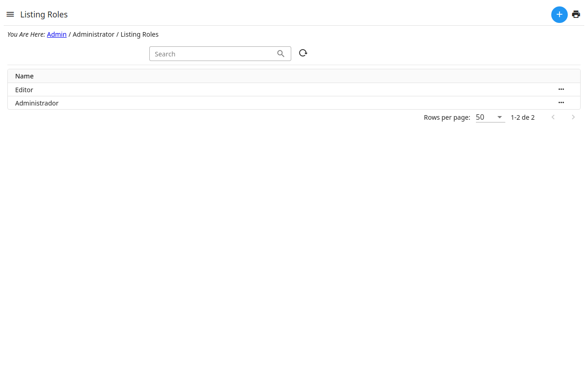

# Roles

A role is a set of permissions: what its users may see and do in the admin.
A user has one or more roles (see ).

- The role **Administrator** may do everything.
- Make a role for each kind of work — editing the site, answering the
  contact form… — and give it only what that work needs.

## The permissions

A role's permissions are **lines in order**: a resource, which **allows**, or
with a prefix — `deny ` **denies**, `allow ` forces the allow of what matches
it, over the earlier denies, `reset ` takes from the earlier lines what
matches it. A group is several lines: `admin:users:{*, deny @delete}`. They
are edited in the **field of the permissions**: the tree of the permissions of
the admin kept to what they touch, each row with its prefix, the **+** of
what may follow it and the trash — and permissions added from a text. All of
it, with examples, in .

A user's roles have an **order** too: a role's lines come after the earlier
one's, so it may deny what the earlier allows, or allow (`allow`) what it
denies. The user's page **Permissions** shows the result.

A change to a role counts at once for all its users.

## System roles

Some roles are the **system**'s: the application needs them, and makes them
by itself when missing — the listing and the detail say *System role* and
what each one is for.

- A system role is **not deleted** nor **renamed**.
- Its **permissions** can be changed as any role's, and go back to the
  originals with the action **Reset the permissions**, in the detail.
- A system role whose permissions are the system's own — the
  **Administrator**, who may do everything — has no permissions to change.
- A role of the same name that existed already becomes the system's: its
  permissions are kept, and the originals it lacks, added.
