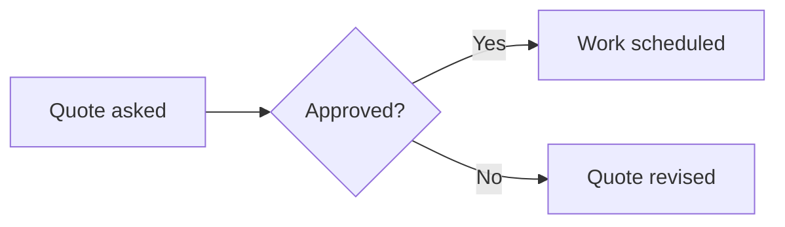

# Rich text

The rich text editor formats the text as it is written: its bar has the
formats (bold, italic, headings, lists, quotes, code, alignment, colors…),
undo and redo, full screen and, after them, the buttons below.

## Tables

- The **table** button builds a table as a sheet — or opens the table under
  the cursor in it:
  - rows and columns put before or after the chosen ones, or taken out;
  - cells merged (drag over them, or Shift and a click) and unmerged;
  - the first row the header, or not;
  - the content of the cells placed across (left, center, right — whole
    columns chosen: the columns') and up and down (top, middle, bottom);
  - the widths of the columns: drag the border of a column's letter, in
    pixels or in parts of the table (a double click: automatic);
  - the table **fluid** (as wide as the text, the default) or as wide as its
    columns, placed left, in the center or right;
  - **Paste**: the cells copied from a spreadsheet (Excel, LibreOffice), a
    table of a page, a CSV text — its separator detected or chosen — or a CSV
    file; Ctrl+V in a cell spreads the cells copied over the sheet;
  - the expand button takes the whole screen.
- In the text, drag the border between two columns to size them; the
  **cells** button places the content of the cells under the cursor.

## Footnotes

The **footnote** button opens the notes of the text: a new one at the cursor,
or one there pointed at again; edit, rename or delete a note. A number in
the text, clicked, opens its note. On the site the notes are at the end, and
a number shows its note in a balloon.

## Links

The **link** button links the text chosen: type the address, or search a
page of the site — in the admin, a record too (a page, a post, an issue…):
its address in the admin —; open it in a new tab or not; on a link, take it
out.

## Link cards

The **link card** button puts a page of the site — in the admin, a record —
as a card: its cover, its title and its summary, in the language of the page
that shows it, to who may see it (else a plain link). Search it, or type its
address. An address of the site pasted alone on a line becomes its card
(Ctrl+Z: the text pasted). The bin of a card takes it out.

<div class="mdkit-link-card" data-href="admin:user_docs:">admin:user_docs:</div>

## Formulas

The **Σ** button writes a formula in LaTeX — in the line or on a line of its
own —, its preview as you write. A formula clicked opens it again (change it,
or remove it).

Euler's identity <span data-type="inline-math" data-latex="e^{i\pi} + 1 = 0"></span> in the line; on a line of its own:

<div data-type="block-math" data-latex="x = \frac{-b \pm \sqrt{b^2 - 4ac}}{2a}"></div>

The [functions KaTeX knows](https://katex.org/docs/supported.html) are the
ones a formula may use.

## Diagrams

The **diagram** button writes a diagram in
[Mermaid](https://mermaid.js.org/intro/syntax-reference.html) — flowcharts,
sequences, timelines… —, its preview as you write. A diagram clicked opens
it again.



<pre><code class="language-mermaid">graph LR
  A[Quote asked] --&gt; B{Approved?}
  B --&gt;|Yes| C[Work scheduled]
  B --&gt;|No| D[Quote revised]</code></pre>

## Sections that fold

The **section** button makes the blocks chosen a section that folds: its
title, then its content, hidden until the title is clicked. The same button
on a section makes it its blocks again.

<details><summary>What does a quote include?</summary>
<p>The materials, the labor and the cleaning after the work.</p>
</details>

## Keyboard shortcuts

On a Mac, **⌘** instead of **Ctrl** and **⌥** instead of **Alt**. Some work only
where the editor has their button (underline, highlight, alignment, task
list).

| Action | Keys |
|---|---|
| Bold | <kbd>Ctrl</kbd>+<kbd>B</kbd> |
| Italic | <kbd>Ctrl</kbd>+<kbd>I</kbd> |
| Underline | <kbd>Ctrl</kbd>+<kbd>U</kbd> |
| Strikethrough | <kbd>Ctrl</kbd>+<kbd>Shift</kbd>+<kbd>S</kbd> |
| Inline code | <kbd>Ctrl</kbd>+<kbd>E</kbd> |
| Highlight | <kbd>Ctrl</kbd>+<kbd>Shift</kbd>+<kbd>H</kbd> |
| Heading 1 … 6 | <kbd>Ctrl</kbd>+<kbd>Alt</kbd>+<kbd>1</kbd> … <kbd>6</kbd> |
| Paragraph | <kbd>Ctrl</kbd>+<kbd>Alt</kbd>+<kbd>0</kbd> |
| List | <kbd>Ctrl</kbd>+<kbd>Shift</kbd>+<kbd>8</kbd> |
| Numbered list | <kbd>Ctrl</kbd>+<kbd>Shift</kbd>+<kbd>7</kbd> |
| Task list | <kbd>Ctrl</kbd>+<kbd>Shift</kbd>+<kbd>9</kbd> |
| Quote | <kbd>Ctrl</kbd>+<kbd>Shift</kbd>+<kbd>B</kbd> |
| Code block | <kbd>Ctrl</kbd>+<kbd>Alt</kbd>+<kbd>C</kbd> |
| Align left, center, right, justify | <kbd>Ctrl</kbd>+<kbd>Shift</kbd>+<kbd>L</kbd>, <kbd>E</kbd>, <kbd>R</kbd>, <kbd>J</kbd> |
| Line break (no new paragraph) | <kbd>Shift</kbd>+<kbd>Enter</kbd> |
| List item in, out | <kbd>Tab</kbd>, <kbd>Shift</kbd>+<kbd>Tab</kbd> |
| Undo | <kbd>Ctrl</kbd>+<kbd>Z</kbd> |
| Redo | <kbd>Ctrl</kbd>+<kbd>Shift</kbd>+<kbd>Z</kbd> or <kbd>Ctrl</kbd>+<kbd>Y</kbd> |

Typed at the start of a line, Markdown's marks work too:

| Type | For |
|---|---|
| `# `, `## `, … `###### ` | a heading |
| `- ` or `* ` | a list |
| `1. ` | a numbered list |
| `> ` | a quote |
| ` ``` ` | a code block |
| `---` | a horizontal rule |
| `**text**`, `*text*`, `~~text~~`, `` `code` `` | bold, italic, strikethrough, code |
