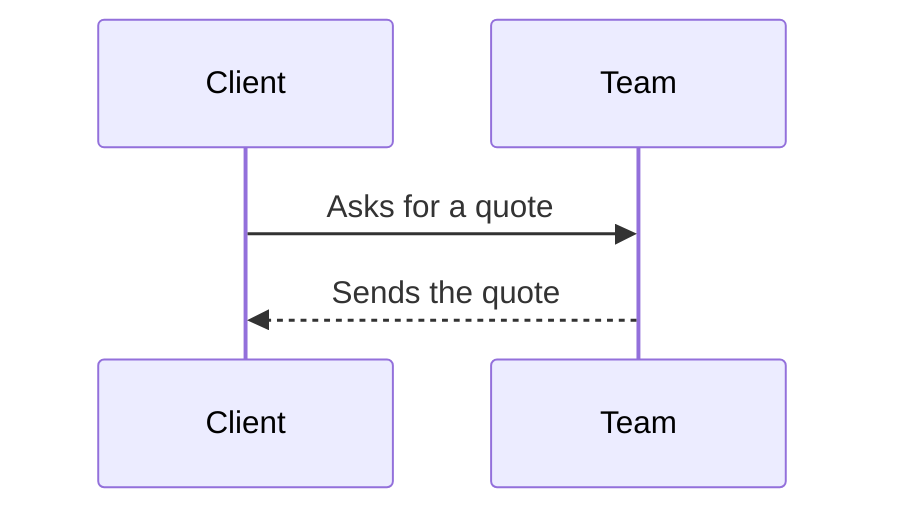

# Markdown

A text in Markdown is written with marks, as GitHub's. The bar puts them for
you; the **?** of the bar lists its shortcuts and opens the guide of
Markdown. The preview shows the text as it will look: beside it (side by
side, its scroll following the text's) or alone.

## Text

```markdown
**bold**, _italic_, ~~struck~~, `code`, [a link](https://example.com)

## A heading (### smaller, … ######)

- a list
1. a numbered list
- [ ] a task

> a quote
```

Pictures: pasted, dropped or chosen (its button), they are kept and written
as ``.

## Tables

```markdown
| Service  | Days | From    |
|----------|:----:|--------:|
| Kitchen  |  10  | $ 8,000 |
| Bathroom |   7  | $ 5,500 |
```

`:--` left, `:-:` center, `--:` right. The **table** button builds it as a
sheet (merged cells, widths, a fluid table or not, the cells' content placed;
then the table is written as HTML), and opens the table under the cursor.

## Footnotes

```markdown
A quote is free[^free].

[^free]: Inside the city.
```

The **footnote** button manages them; Ctrl+click on a `[^…]` opens its note.
**Include Markdown files** puts files at the cursor, their notes renamed so
they do not collide with the text's.

## Links and link cards

The **link** button writes `[text](address)`: an address typed, or a page —
in the admin, a record — searched. A page alone on its line is a **card**:

```markdown
[[/en-us/about]]
```

In the admin, a record: `[[admin:posts:<id>:]]` (its card's search writes
it). An address of the site pasted alone becomes its card (Ctrl+Z: the
text).

## Formulas

```markdown
Inline: $E = mc^2$ or $`e^{i\pi} + 1 = 0`$ — money stays money: $5 and $10.

$$
x = \frac{-b \pm \sqrt{b^2 - 4ac}}{2a}
$$
```

A ```` ```math ```` block is a formula of its own too. It shows:

Inline: <span data-type="inline-math" data-latex="E = mc^2"></span> — money stays money: $5 and $10.

<div data-type="block-math" data-latex="x = \frac{-b \pm \sqrt{b^2 - 4ac}}{2a}"></div>

## Diagrams

````markdown

````

<pre><code class="language-mermaid">sequenceDiagram
  Client-&gt;&gt;Team: Asks for a quote
  Team--&gt;&gt;Client: Sends the quote</code></pre>

## Sections that fold

```markdown
<details>
<summary>What does a quote include?</summary>

The materials, the **labor** and the cleaning after the work.

</details>
```

<details><summary>What does a quote include?</summary>
<p>The materials, the <strong>labor</strong> and the cleaning after the work.</p>
</details>

The buttons **Σ**, **diagram** and **section** write each of them at the
cursor (around the text chosen).
