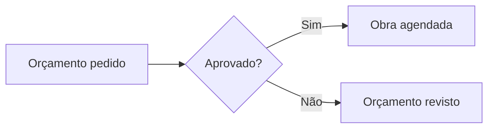

# Texto formatado

O editor de texto formatado formata o texto enquanto se escreve: a barra tem
os formatos (negrito, itálico, títulos, listas, citações, código,
alinhamento, cores…), desfazer e refazer, tela cheia e, depois deles, os
botões abaixo.

## Tabelas

- O botão **tabela** monta uma tabela como uma planilha — ou abre nela a
  tabela sob o cursor:
  - linhas e colunas postas antes ou depois das escolhidas, ou retiradas;
  - células mescladas (arraste sobre elas, ou Shift e um clique) e separadas;
  - a primeira linha como cabeçalho, ou não;
  - o conteúdo das células posicionado na horizontal (esquerda, centro,
    direita — colunas inteiras escolhidas: o das colunas) e na vertical
    (alto, meio, embaixo);
  - a largura das colunas: arraste a borda da letra da coluna, em pixels ou
    em partes da tabela (duplo clique: automática);
  - a tabela **fluida** (da largura do texto, o padrão) ou da largura das
    colunas, à esquerda, ao centro ou à direita;
  - **Colar**: as células copiadas de uma planilha (Excel, LibreOffice), uma
    tabela de uma página, um texto CSV — o separador detectado ou escolhido —
    ou um arquivo CSV; Ctrl+V numa célula espalha as células copiadas pela
    planilha;
  - o botão de expandir ocupa a tela inteira.
- No texto, arraste a borda entre duas colunas para mudar a largura; o botão
  **células** posiciona o conteúdo das células sob o cursor.

## Notas de rodapé

O botão **nota de rodapé** abre as notas do texto: uma nova no cursor, ou
uma já existente apontada de novo; edite, renomeie ou apague uma nota. Um
número no texto, clicado, abre a nota dele. No site as notas ficam no fim, e
um número mostra a nota num balão.

## Links

O botão **link** liga o texto escolhido: digite o endereço, ou busque uma
página do site — no admin, também um registro (uma página, um post, um
chamado…): o endereço dele no admin —; abrir em nova aba ou não; sobre um
link, tire-o.

## Cartões de link

O botão **cartão de link** põe uma página do site — no admin, um registro —
como um cartão: a capa, o título e o resumo, no idioma da página que o
mostra, para quem pode vê-la (senão, um link simples). Busque, ou digite o
endereço. Um endereço do site colado sozinho numa linha vira o cartão dele
(Ctrl+Z: o texto colado). A lixeira de um cartão o tira.

<div class="mdkit-link-card" data-href="admin:user_docs:">admin:user_docs:</div>

## Fórmulas

O botão **Σ** escreve uma fórmula em LaTeX — na linha ou em linha própria —,
com a prévia enquanto se escreve. Uma fórmula clicada abre de novo (mude-a ou
remova-a).

A identidade de Euler <span data-type="inline-math" data-latex="e^{i\pi} + 1 = 0"></span> na linha; em linha própria:

<div data-type="block-math" data-latex="x = \frac{-b \pm \sqrt{b^2 - 4ac}}{2a}"></div>

As [funções que o KaTeX conhece](https://katex.org/docs/supported.html) são as
que uma fórmula pode usar.

## Diagramas

O botão **diagrama** escreve um diagrama em
[Mermaid](https://mermaid.js.org/intro/syntax-reference.html) — fluxogramas,
sequências, linhas do tempo… —, com a prévia enquanto se escreve. Um
diagrama clicado abre de novo.



<pre><code class="language-mermaid">graph LR
  A[Orçamento pedido] --&gt; B{Aprovado?}
  B --&gt;|Sim| C[Obra agendada]
  B --&gt;|Não| D[Orçamento revisto]</code></pre>

## Seções recolhíveis

O botão **seção** faz dos blocos escolhidos uma seção recolhível: o título,
depois o conteúdo, escondido até o título ser clicado. O mesmo botão sobre
uma seção a desfaz em blocos.

<details><summary>O que um orçamento inclui?</summary>
<p>Os materiais, a mão de obra e a limpeza depois da obra.</p>
</details>

## Teclas de atalho

No Mac, **⌘** no lugar de **Ctrl** e **⌥** no lugar de **Alt**. Algumas só valem
onde o editor tem o botão correspondente (sublinhado, destaque, alinhamento,
lista de tarefas).

| Ação | Teclas |
|---|---|
| Negrito | <kbd>Ctrl</kbd>+<kbd>B</kbd> |
| Itálico | <kbd>Ctrl</kbd>+<kbd>I</kbd> |
| Sublinhado | <kbd>Ctrl</kbd>+<kbd>U</kbd> |
| Riscado | <kbd>Ctrl</kbd>+<kbd>Shift</kbd>+<kbd>S</kbd> |
| Código na linha | <kbd>Ctrl</kbd>+<kbd>E</kbd> |
| Destaque | <kbd>Ctrl</kbd>+<kbd>Shift</kbd>+<kbd>H</kbd> |
| Título 1 … 6 | <kbd>Ctrl</kbd>+<kbd>Alt</kbd>+<kbd>1</kbd> … <kbd>6</kbd> |
| Parágrafo | <kbd>Ctrl</kbd>+<kbd>Alt</kbd>+<kbd>0</kbd> |
| Lista | <kbd>Ctrl</kbd>+<kbd>Shift</kbd>+<kbd>8</kbd> |
| Lista numerada | <kbd>Ctrl</kbd>+<kbd>Shift</kbd>+<kbd>7</kbd> |
| Lista de tarefas | <kbd>Ctrl</kbd>+<kbd>Shift</kbd>+<kbd>9</kbd> |
| Citação | <kbd>Ctrl</kbd>+<kbd>Shift</kbd>+<kbd>B</kbd> |
| Bloco de código | <kbd>Ctrl</kbd>+<kbd>Alt</kbd>+<kbd>C</kbd> |
| Alinhar à esquerda, ao centro, à direita, justificar | <kbd>Ctrl</kbd>+<kbd>Shift</kbd>+<kbd>L</kbd>, <kbd>E</kbd>, <kbd>R</kbd>, <kbd>J</kbd> |
| Quebra de linha (sem novo parágrafo) | <kbd>Shift</kbd>+<kbd>Enter</kbd> |
| Item da lista para dentro, para fora | <kbd>Tab</kbd>, <kbd>Shift</kbd>+<kbd>Tab</kbd> |
| Desfazer | <kbd>Ctrl</kbd>+<kbd>Z</kbd> |
| Refazer | <kbd>Ctrl</kbd>+<kbd>Shift</kbd>+<kbd>Z</kbd> ou <kbd>Ctrl</kbd>+<kbd>Y</kbd> |

Ao digitar no começo de uma linha, o editor também entende as marcas do
Markdown:

| Digite | Para |
|---|---|
| `# `, `## `, … `###### ` | um título |
| `- ` ou `* ` | uma lista |
| `1. ` | uma lista numerada |
| `> ` | uma citação |
| ` ``` ` | um bloco de código |
| `---` | uma linha horizontal |
| `**texto**`, `*texto*`, `~~texto~~`, `` `código` `` | negrito, itálico, riscado, código |
