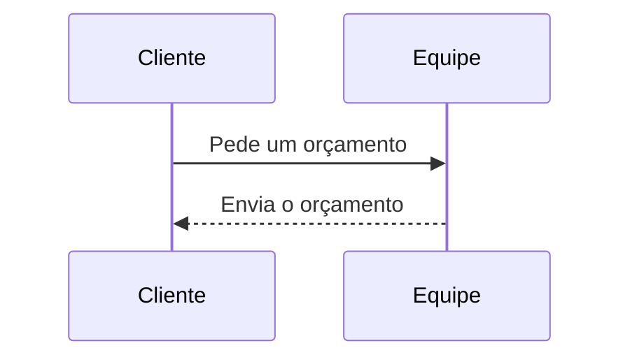

# Markdown

Um texto em Markdown é escrito com marcas, como no GitHub. A barra as põe
para você; o **?** da barra lista os atalhos e abre o guia do Markdown. A
prévia mostra o texto como vai ficar: ao lado (lado a lado, a rolagem
acompanhando a do texto) ou sozinha.

## Texto

```markdown
**negrito**, _itálico_, ~~riscado~~, `código`, [um link](https://example.com)

## Um título (### menor, … ######)

- uma lista
1. uma lista numerada
- [ ] uma tarefa

> uma citação
```

Imagens: coladas, soltas ou escolhidas (o botão), são guardadas e escritas
como ``.

## Tabelas

```markdown
| Serviço   | Dias | A partir de |
|-----------|:----:|------------:|
| Cozinha   |  10  |    R$ 8.000 |
| Banheiro  |   7  |    R$ 5.500 |
```

`:--` à esquerda, `:-:` ao centro, `--:` à direita. O botão **tabela** a monta
como planilha (células mescladas, larguras, tabela fluida ou não, o conteúdo
das células posicionado; então a tabela é escrita em HTML), e abre a tabela
sob o cursor.

## Notas de rodapé

```markdown
Um orçamento é grátis[^gratis].

[^gratis]: Dentro da cidade.
```

O botão **nota de rodapé** as administra; Ctrl+clique num `[^…]` abre a nota.
**Incluir arquivos Markdown** põe arquivos no cursor, com as notas
renomeadas para não colidir com as do texto.

## Links e cartões de link

O botão **link** escreve `[texto](endereço)`: um endereço digitado, ou uma
página — no admin, um registro — buscada. Uma página sozinha na linha é um
**cartão**:

```markdown
[[/pt-br/sobre]]
```

No admin, um registro: `[[admin:posts:<id>:]]` (a busca do cartão o
escreve). Um endereço do site colado sozinho vira o cartão dele (Ctrl+Z: o
texto).

## Fórmulas

```markdown
Na linha: $E = mc^2$ ou $`e^{i\pi} + 1 = 0`$ — dinheiro continua dinheiro: $5 e $10.

$$
x = \frac{-b \pm \sqrt{b^2 - 4ac}}{2a}
$$
```

Um bloco ```` ```math ```` também é uma fórmula em linha própria. Aparece
assim:

Na linha: <span data-type="inline-math" data-latex="E = mc^2"></span> — dinheiro continua dinheiro: $5 e $10.

<div data-type="block-math" data-latex="x = \frac{-b \pm \sqrt{b^2 - 4ac}}{2a}"></div>

## Diagramas

````markdown

````

<pre><code class="language-mermaid">sequenceDiagram
  Cliente-&gt;&gt;Equipe: Pede um orçamento
  Equipe--&gt;&gt;Cliente: Envia o orçamento</code></pre>

## Seções recolhíveis

```markdown
<details>
<summary>O que um orçamento inclui?</summary>

Os materiais, a **mão de obra** e a limpeza depois da obra.

</details>
```

<details><summary>O que um orçamento inclui?</summary>
<p>Os materiais, a <strong>mão de obra</strong> e a limpeza depois da obra.</p>
</details>

Os botões **Σ**, **diagrama** e **seção** escrevem cada um deles no cursor
(em volta do texto escolhido).

## Botões

```markdown
<div data-type="buttons" data-align="center"><a data-type="button" href="https://katex.org/" title="O que desenha as fórmulas" data-color="primary" data-icon-left="mdi-sigma" target="_blank" rel="noopener">KaTeX</a><a data-type="button" href="https://mermaid.js.org/" data-color="success" data-icon-right="mdi-open-in-new" target="_blank" rel="noopener">Mermaid</a></div>
```

<div data-type="buttons" data-align="center"><a data-type="button" href="https://katex.org/" title="O que desenha as fórmulas" data-color="primary" data-icon-left="mdi-sigma" target="_blank" rel="noopener">KaTeX</a><a data-type="button" href="https://mermaid.js.org/" data-color="success" data-icon-right="mdi-open-in-new" target="_blank" rel="noopener">Mermaid</a></div>

## Abas

O conteúdo de cada aba é Markdown, entre linhas em branco:

```markdown
<div data-type="tabs" data-align="start">
<div data-type="tab" data-title="Cozinha" data-color="primary" data-icon-left="mdi-silverware-fork-knife">

Armários e bancadas em **10 dias**.

</div>
<div data-type="tab" data-title="Banheiro" data-icon-left="mdi-shower">

Azulejos e louças em 7 dias.

</div>
</div>
```

<div data-type="tabs" data-align="start">
<div data-type="tab" data-title="Cozinha" data-color="primary" data-icon-left="mdi-silverware-fork-knife">

Armários e bancadas em **10 dias**.

</div>
<div data-type="tab" data-title="Banheiro" data-icon-left="mdi-shower">

Azulejos e louças em 7 dias.

</div>
</div>

Os botões **botões** e **abas** da barra abrem os diálogos deles — sobre o
bloco onde está o cursor, ou um novo: o link de cada botão (uma página do site
ou um registro do admin), título (vazio, o da página), descrição, cor e
ícones; o título, a cor, os ícones e o conteúdo de cada aba, escrito no mesmo
editor. Impressas, as abas aparecem todas, cada uma num quadro.

## Teclas de atalho

No Mac, **⌘** no lugar de **Ctrl** e **⌥** no lugar de **Alt**.

| Ação | Teclas |
|---|---|
| Negrito | <kbd>Ctrl</kbd>+<kbd>B</kbd> |
| Itálico | <kbd>Ctrl</kbd>+<kbd>I</kbd> |
| Link | <kbd>Ctrl</kbd>+<kbd>K</kbd> |
| Título menor, maior | <kbd>Ctrl</kbd>+<kbd>H</kbd>, <kbd>Ctrl</kbd>+<kbd>Shift</kbd>+<kbd>H</kbd> |
| Título 1 … 6 | <kbd>Ctrl</kbd>+<kbd>Alt</kbd>+<kbd>1</kbd> … <kbd>6</kbd> |
| Limpar o bloco | <kbd>Ctrl</kbd>+<kbd>E</kbd> |
| Citação | <kbd>Ctrl</kbd>+<kbd>'</kbd> |
| Lista | <kbd>Ctrl</kbd>+<kbd>L</kbd> |
| Lista numerada | <kbd>Ctrl</kbd>+<kbd>Alt</kbd>+<kbd>L</kbd> |
| Lista de tarefas | <kbd>Ctrl</kbd>+<kbd>Shift</kbd>+<kbd>L</kbd> |
| Código | <kbd>Ctrl</kbd>+<kbd>Alt</kbd>+<kbd>C</kbd> |
| Imagem (onde se pode pôr imagens) | <kbd>Ctrl</kbd>+<kbd>Alt</kbd>+<kbd>I</kbd> |
| Desfazer | <kbd>Ctrl</kbd>+<kbd>Z</kbd> |
| Refazer | <kbd>Ctrl</kbd>+<kbd>Y</kbd> ou <kbd>Ctrl</kbd>+<kbd>Shift</kbd>+<kbd>Z</kbd> |
| Pré-visualizar | <kbd>Ctrl</kbd>+<kbd>P</kbd> |
| Lado a lado | <kbd>F9</kbd> |
| Tela cheia, sair dela | <kbd>F11</kbd>, <kbd>Esc</kbd> |

Numa lista, <kbd>Enter</kbd> continua a lista; <kbd>Tab</kbd> e
<kbd>Shift</kbd>+<kbd>Tab</kbd> mudam o recuo. <kbd>Ctrl</kbd>+clique numa
referência `[^…]` abre a nota.
